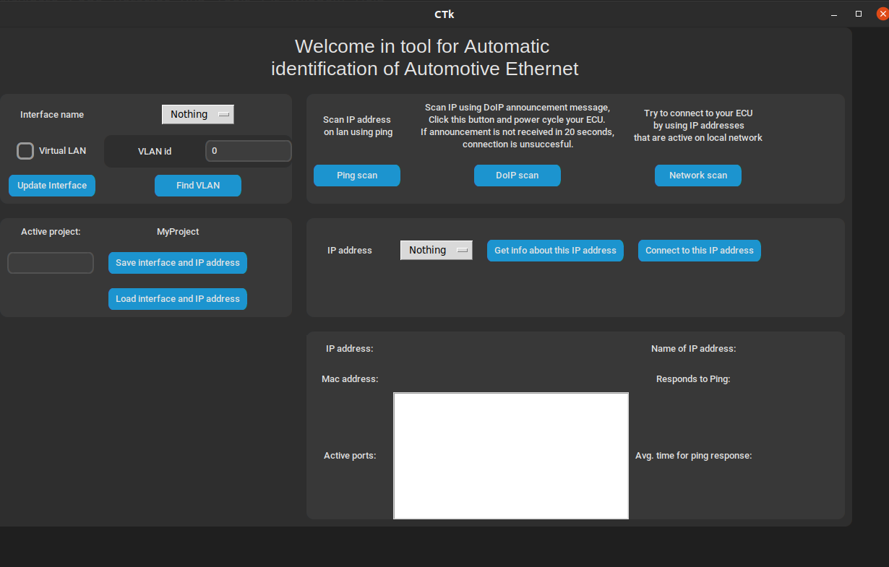
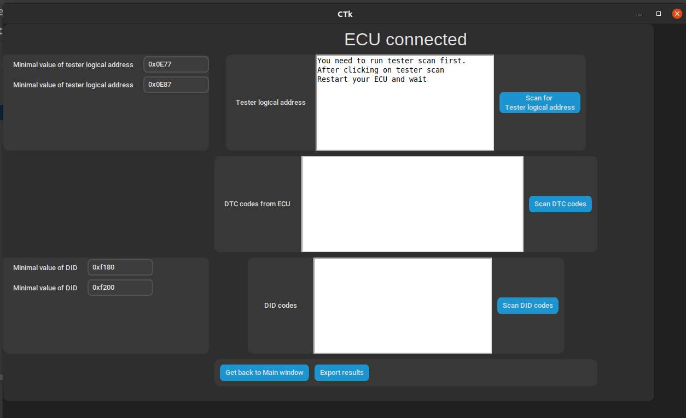

## Automoto Diagnostic

A simple GUI tool for automatic diagnostic of UDS over Automotive Ethernet

## Rationale

Although there are many tools for CAN diagnostic, we lack such tools for Automotive Ethernet. This tool aims to fill
that gap and help others to catch up with current technology and do a simple diagnostic, with a minimum understanding of
this technology.

## How to install

This tool is currently developed only for Linux. It uses many libraries which are listed here. Currenty you need to
install these libraries by youself.

1. Install a modern Linux dist. Tested with Ubuntu 22.04.
2. Install pip

        sudo apt install pip

3. Install customtkinter,doipclient,ifconfig-parser,pyshark,udsoncan

        pip3 install customtkinter
        pip3 install doipclient
        pip3 install ifconfig-parser
        pip3 install pyshark
        pip3 install udsoncan
        pip3 install tk
        sudo apt install python3-tk

4. Go to Automoto Diagnostic folder and run this command:

        python main.py

5. For CAN simulation (e.g. ignition on) can-utils and python can has to be installed (commands not tested). Neccesarry for testing with our ECUs.

        pip3 install python-can
        sudo apt install can-utils

## Features and Architecture

Automoto Diagnostic has a simple GUI interface, where is needed configuration for diagnostic. It support:

- discovery of ECU on LAN
- discovery of ECU parameters
- scan od DID and DTC by an ECU
- enables to save and load current configuration

## How to use

When you open Automoto Diagnostic, you will see this screen.

### Example of connection to ECU:

1. In the top left corner you can see section with interface. To find current available interfaces click on Update
   Interface. From drop-down menu you can choose inteface on which you want to do diagnostic. If your ECU does not
   respond on interface, it's possible it requires vlan id. To modify interface click on virtual Lan and than select id.
   If zou don't know vlan id, click on find vlan that will try to find vlan id for you.

2. After you selected interface, you can click on one of the scan button. Each button find ECU IP address differenty.
   For example according to specification, ECU is required to send vehicle annoucenemt message 3 times with it's ip
   address and logical address.

3. Turn off your ECU, click on DoIP scan and then turn on your ECU. In less than 20 seconds, IP address should be
   recieved and you can see the address in drop-down menu in IP address section. Choose IP addrress you want to connect
   to.

4. If you want informations about active ports, click on get info about this IP address. If you want to connect to ECU,
   click on Connect to this IP address.

5. Before you can scan services, you have to scan for tester logical address. To do that, click on scan for tester logical address. After that restart your ECU and wait before scan is complete. This can take a lot of time.

6. After scan is complete you can scan DTC or DID. If you want to scan DID, it is good to narrow range using parameters, as searching whole range can take a lot of time.

